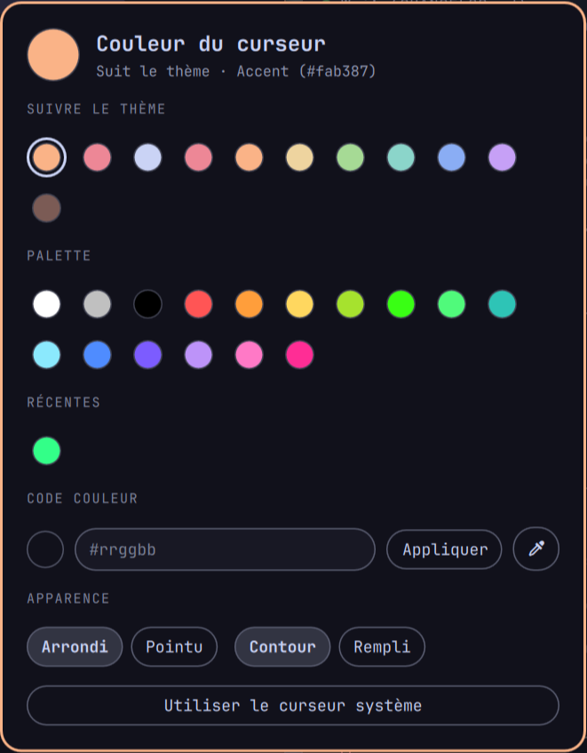

# Cursor Color

Plugin Omarchy qui colore le curseur de la souris :

- **automatiquement selon le thème** — par défaut il prend la couleur
  `accent` du thème actif et se met à jour tout seul à chaque
  `omarchy theme set` ;
- **ou avec la couleur de ton choix** — depuis une palette, un code hex
  (`#rrggbb`), ou une couleur prise à l'écran avec la pipette.



Basé sur [SmoothPixels/cursor-accent](https://github.com/SmoothPixels/cursor-accent) :
même moteur (curseur [Bibata](https://github.com/ful1e5/Bibata_Cursor)
recoloré et compilé avec `hyprcursor-util`, déjà installé avec Hyprland),
avec en plus un vrai sélecteur graphique, le choix de n'importe quelle couleur
du thème, et le suivi du thème sans hook à installer.

## Installation

```sh
omarchy plugin add https://github.com/LDockwiller/cursor-color.git --enable
```

C'est tout : le service du plugin applique la couleur dès qu'il est chargé,
puis surveille le `colors.toml` du thème actif et recolore le curseur à chaque
changement de thème.

> Si tu utilisais **cursor-accent**, désactive-le pour que les deux plugins ne
> se battent pas pour le curseur :
> `omarchy plugin disable io.github.smoothpixels.cursor-accent`

## Choisir la couleur

Ouvre le sélecteur :

```sh
~/.config/omarchy/plugins/io.github.ldockwiller.cursor-color/cursor-color open
```

| Section | Effet |
| --- | --- |
| **Suivre le thème** | Les couleurs du thème actif (accent, curseur du terminal, texte, rouge, bleu…). Le curseur garde ce *rôle* et change de teinte avec le thème. |
| **Palette** | 16 couleurs prédéfinies. Couleur fixe, indépendante du thème. |
| **Récentes** | Les 8 dernières couleurs fixes utilisées. |
| **Code couleur** | Tape un code `#rrggbb` (ou `#rgb`) puis Entrée / *Appliquer*. Le bouton pipette prend une couleur n'importe où à l'écran (`hyprpicker`). |
| **Apparence** | Forme *Arrondi* / *Pointu*, et style *Contour* (contour coloré, corps sombre) ou *Rempli* (corps coloré, contour sombre). |
| **Utiliser le curseur système** | Désactive la recoloration et revient au curseur par défaut. |

`Échap` ou un clic en dehors ferme le sélecteur.

### Raccourci clavier (optionnel)

Dans `~/.config/hypr/bindings.conf` :

```
bindd = SUPER CTRL, C, Couleur du curseur, exec, ~/.config/omarchy/plugins/io.github.ldockwiller.cursor-color/cursor-color open
```

### Entrée dans le menu Omarchy (optionnel)

Ajoute *Style → Couleur du curseur* au menu Omarchy :

```sh
~/.config/omarchy/plugins/io.github.ldockwiller.cursor-color/tools/install-menu-entry.sh
```

Pour l'enlever, supprime la ligne `"style.cursorcolor"` de
`~/.config/omarchy/extensions/omarchy-menu.jsonc`.

## En ligne de commande

```sh
cursor-color open                    # ouvre le sélecteur
cursor-color theme                   # suit l'accent du thème (défaut)
cursor-color theme blue              # suit une autre couleur du thème (blue, magenta, cursor, …)
cursor-color set '#39ff14'           # couleur fixe
cursor-color pick                    # couleur fixe prise à l'écran
cursor-color default                 # curseur système
cursor-color shape modern|original   # arrondi / pointu
cursor-color style outline|filled    # contour / rempli
cursor-color apply [--force]         # ré-applique (--force recompile)
cursor-color status                  # affiche la config en JSON
```

(`cursor-color` = `~/.config/omarchy/plugins/io.github.ldockwiller.cursor-color/cursor-color`.)

La config est stockée dans `~/.local/state/cursor-color/config.json`, hors du
dossier du plugin, donc `omarchy plugin update` ne la réinitialise jamais.

## Désinstallation

```sh
omarchy plugin remove io.github.ldockwiller.cursor-color
rm -rf ~/.local/share/icons/Omarchy-CursorColor ~/.local/state/cursor-color
hyprctl setcursor default 24
```

## Fonctionnement

- `Service.qml` (service `keepLoaded`) lance `recolor.py` au démarrage du shell
  et chaque fois que `~/.local/state/omarchy/current/theme/colors.toml` change.
- `recolor.py` résout la couleur, patche une copie de `config/render.json`,
  compile le thème hyprcursor dans `~/.local/share/icons/Omarchy-CursorColor`
  puis l'applique avec `hyprctl setcursor`. Si les couleurs n'ont pas changé,
  il saute la compilation.
- `Picker.qml` (overlay) est le sélecteur ; il passe par la commande
  `cursor-color`, comme le terminal.

`src/`, `svg/` et `config/` proviennent de
[rtgiskard/bibata_cursor](https://github.com/rtgiskard/bibata_cursor) (voir
[NOTICE.md](NOTICE.md)). Le plugin est donc sous licence GPL-3.0-or-later.
